# Node.js CI/CD Pipeline with GitHub Actions and Docker Hub

This repository demonstrates a CI/CD pipeline for a Node.js application using **GitHub Actions** and **Docker Hub**. Whenever code is pushed to the `main` branch, the workflow installs dependencies, runs tests, builds a Docker image, and pushes the image to Docker Hub.

## Architecture

```mermaid
flowchart LR
    A[Developer pushes code<br/>to main] --> B[GitHub Repository]
    B --> C[GitHub Actions workflow]
    C --> D[Checkout code]
    D --> E[Set up Node.js 20]
    E --> F[Install dependencies<br/>npm ci]
    F --> G[Run tests<br/>npm test]
    G --> H[Authenticate to Docker Hub<br/>GitHub Secrets]
    H --> I[Build Docker image]
    I --> J[Push image to Docker Hub]
```



## Pipeline Workflow

1. **Trigger:** A push to the `main` branch starts the workflow.
2. **Checkout:** `actions/checkout@v4` checks out the repository code.
3. **Set up Node.js:** `actions/setup-node@v4` configures Node.js 20 and npm dependency caching.
4. **Install dependencies:** `npm ci` installs the exact dependencies from `package-lock.json`.
5. **Run tests:** `npm test` runs the project's test suite. The workflow stops if this step fails.
6. **Log in to Docker Hub:** `docker/login-action@v3` authenticates using GitHub Actions secrets.
7. **Build image:** Docker builds the application image and tags it as `<DOCKERHUB_USERNAME>/nodejs-demo-app:latest`.
8. **Push image:** The image is uploaded to Docker Hub.

## Prerequisites

- A GitHub repository containing the Node.js application.
- A `package.json` and `package-lock.json`.
- A working `npm test` script in `package.json`.
- A `Dockerfile` in the repository root.
- A Docker Hub account and access token.

## Configure GitHub Secrets

In your GitHub repository, open **Settings → Secrets and variables → Actions → New repository secret** and add:

| Secret name | Value |
|---|---|
| `DOCKERHUB_USERNAME` | Your Docker Hub username |
| `DOCKERHUB_TOKEN` | A Docker Hub access token |

Use a Docker Hub access token rather than your account password. Never commit secrets directly to the repository.

## Workflow File

Save the workflow as:

```text
.github/workflows/nodejs-ci.yml
```

Example workflow:

```yaml
name: Node.js CI/CD

on:
  push:
    branches:
      - main

jobs:
  build-and-push:
    runs-on: ubuntu-latest

    steps:
      - name: Checkout code
        uses: actions/checkout@v4

      - name: Set up Node.js
        uses: actions/setup-node@v4
        with:
          node-version: 20
          cache: npm

      - name: Install dependencies
        run: npm ci

      - name: Run tests
        run: npm test

      - name: Log in to Docker Hub
        uses: docker/login-action@v3
        with:
          username: ${{ secrets.DOCKERHUB_USERNAME }}
          password: ${{ secrets.DOCKERHUB_TOKEN }}

      - name: Build Docker image
        run: |
          docker build -t ${{ secrets.DOCKERHUB_USERNAME }}/nodejs-demo-app:latest .

      - name: Push Docker image
        run: |
          docker push ${{ secrets.DOCKERHUB_USERNAME }}/nodejs-demo-app:latest
```

## Getting Started

1. Add your Node.js application, `package.json`, `package-lock.json`, and `Dockerfile` to the repository.
2. Ensure the `test` script in `package.json` is configured and can run successfully.
3. Add the two Docker Hub secrets listed above.
4. Commit and push your changes to the `main` branch:

   ```bash
   git add .
   git commit -m "Add Node.js CI/CD workflow"
   git push origin main
   ```

5. Open the repository's **Actions** tab to monitor the workflow run.
6. After a successful run, check Docker Hub for the `nodejs-demo-app` image.

## Docker Image

The workflow publishes the image using this tag:

```text
<DOCKERHUB_USERNAME>/nodejs-demo-app:latest
```

For example, if your Docker Hub username is `exampleuser`, the image name will be:

```text
exampleuser/nodejs-demo-app:latest
```

## Troubleshooting

- **`npm ci` fails:** Confirm that `package-lock.json` is committed and matches `package.json`.
- **Tests fail:** Run `npm test` locally and fix the failing tests before pushing again.
- **Docker login fails:** Check that the repository secrets are named correctly and that the access token is valid.
- **Docker build fails:** Verify that the `Dockerfile` exists at the repository root and that the build context includes the required files.
- **Push is denied:** Confirm that the Docker Hub account has permission to push to the target repository.

## Future Improvements

- Add image tags based on the Git commit SHA or release version instead of relying only on `latest`.
- Add vulnerability scanning for the Docker image and dependencies.
- Add deployment to a staging or production environment after successful tests.
- Configure branch protection and required status checks.

## License

Add a license file if you intend to distribute or reuse this project publicly.
